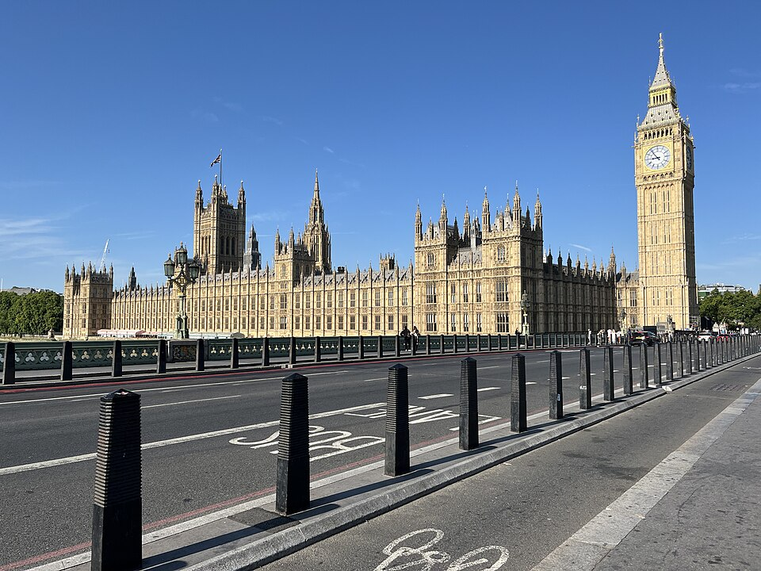
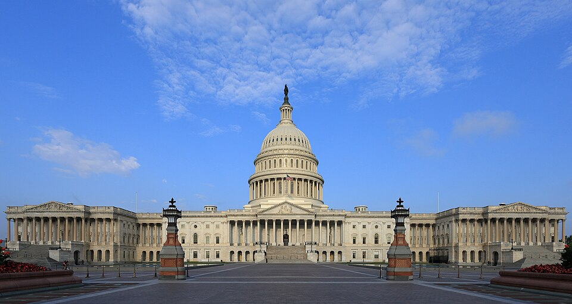
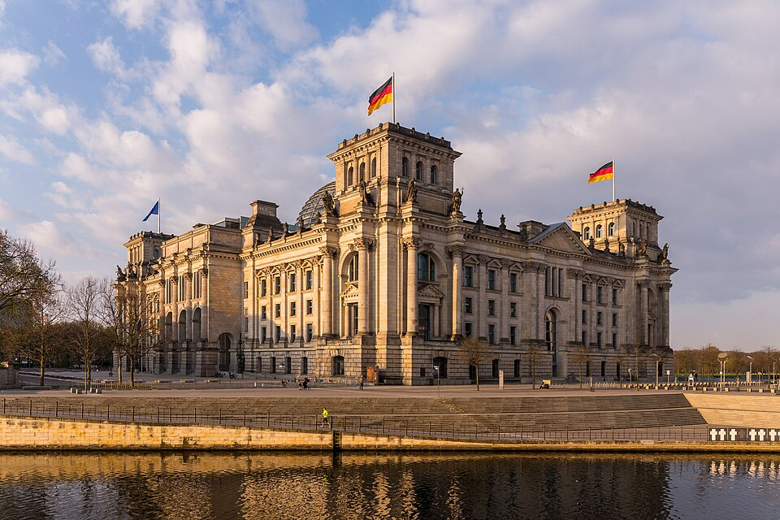

+++
title = "House Proud: Parliament Buildings Quiz"
licence = "CC BY-SA 4.0"
time_limit = 20
max_points = 1000
scoring = "linear"
floor = 0.5

[[sources]]
title = "Palace of Westminster"
url = "https://en.wikipedia.org/wiki/Palace_of_Westminster"
revision = "2026-11-18"

[[sources]]
title = "United States Capitol"
url = "https://en.wikipedia.org/wiki/United_States_Capitol"
revision = "2026-11-20"

[[sources]]
title = "Reichstag building"
url = "https://en.wikipedia.org/wiki/Reichstag_building"
revision = "2026-11-15"

[[sources]]
title = "Parliament House, Canberra"
url = "https://en.wikipedia.org/wiki/Parliament_House,_Canberra"
revision = "2026-11-15"

[[sources]]
title = "Hungarian Parliament Building"
url = "https://en.wikipedia.org/wiki/Hungarian_Parliament_Building"
revision = "2026-10-12"

[[sources]]
title = "Palace of the Parliament"
url = "https://en.wikipedia.org/wiki/Palace_of_the_Parliament"
revision = "2026-10-15"

[[sources]]
title = "Parliament Hill"
url = "https://en.wikipedia.org/wiki/Parliament_Hill"
revision = "2026-11-03"

[[sources]]
title = "Brazilian National Congress"
url = "https://en.wikipedia.org/wiki/Brazilian_National_Congress"
revision = "2026-11-15"

[[sources]]
title = "Scottish Parliament Building"
url = "https://en.wikipedia.org/wiki/Scottish_Parliament_Building"
revision = "2026-11-04"

[[images]]
file = "images/palace-of-westminster-as-seen-from-westminster-bridge.jpg"
author = "ThatsTheBoss"
licence = "CC0"
source = "https://commons.wikimedia.org/wiki/File:Palace_of_Westminster_as_seen_from_Westminster_Bridge.jpg"

[[images]]
file = "images/us-capitol-east-side.jpg"
author = "Martin Falbisoner"
licence = "CC BY-SA 3.0"
source = "https://commons.wikimedia.org/wiki/File:US_Capitol_east_side.JPG"

[[images]]
file = "images/reichstagsgeb-ude-berlin-mitte-170402-ako.jpg"
author = "Ansgar Koreng"
licence = "CC BY-SA 3.0 de"
source = "https://commons.wikimedia.org/wiki/File:Reichstagsgeb%C3%A4ude,_Berlin-Mitte,_170402,_ako.jpg"
+++

## This is the national parliament building of which country?

- [ ] Hungary
- [ ] Canada
- [x] United Kingdom
- [ ] France

Source: https://en.wikipedia.org/wiki/Palace_of_Westminster

## What is the official name of this building?

- [ ] Palace of Whitehall
- [ ] Buckingham Palace
- [ ] Westminster Abbey
- [x] Palace of Westminster

Source: https://en.wikipedia.org/wiki/Palace_of_Westminster

## Which architect won the competition to design the new London parliament after the 1834 fire?

- [x] Charles Barry
- [ ] Augustus Pugin
- [ ] John Soane
- [ ] James Wyatt

Source: https://en.wikipedia.org/wiki/Palace_of_Westminster

## This is the national parliament building of which country?

- [ ] Canada
- [ ] France
- [x] United States
- [ ] Brazil

Source: https://en.wikipedia.org/wiki/United_States_Capitol

## What is the official name of this building?

- [ ] Congress Hall
- [ ] Federal Hall
- [ ] Independence Hall
- [x] United States Capitol

Source: https://en.wikipedia.org/wiki/United_States_Capitol

## In which year was the US Capitol partly destroyed when British forces burned Washington?

- [ ] 1866
- [ ] 1793
- [ ] 1800
- [x] 1814

Source: https://en.wikipedia.org/wiki/United_States_Capitol

## This is the national parliament building of which country?

- [ ] Hungary
- [ ] Romania
- [ ] Austria
- [x] Germany

Source: https://en.wikipedia.org/wiki/Reichstag_building

## What is the official name of this building?

- [x] Reichstag building
- [ ] Kroll Opera House
- [ ] Königsplatz Palace
- [ ] Bundestag building

Source: https://en.wikipedia.org/wiki/Reichstag_building

## Who redesigned Berlin's parliament building between 1995 and 1999?

- [ ] Gottfried Böhm
- [ ] Otto Lessing
- [ ] Paul Wallot
- [x] Norman Foster

Source: https://en.wikipedia.org/wiki/Reichstag_building

## Australia's Parliament House, opened by Elizabeth II in 1988, is in which city?

- [x] Canberra
- [ ] Adelaide
- [ ] Sydney
- [ ] Melbourne

Source: https://en.wikipedia.org/wiki/Parliament_House,_Canberra

## The Hungarian Parliament Building stands on the bank of which river?

- [ ] Rhine
- [ ] Vltava
- [x] Danube
- [ ] Tisza

Source: https://en.wikipedia.org/wiki/Hungarian_Parliament_Building

## Which country's Palace of the Parliament is said to be the heaviest building in the world?

- [ ] Bulgaria
- [ ] Hungary
- [x] Romania
- [ ] North Korea

Source: https://en.wikipedia.org/wiki/Palace_of_the_Parliament

## Which tower on Canada's Parliament Hill was completed in 1927 to honour WWI dead?

- [x] Peace Tower
- [ ] Elizabeth Tower
- [ ] Liberty Tower
- [ ] Victoria Tower

Source: https://en.wikipedia.org/wiki/Parliament_Hill

## Who designed Brazil's National Congress building in Brasília?

- [ ] Louis Kahn
- [x] Oscar Niemeyer
- [ ] Romaldo Giurgola
- [ ] Enric Miralles

Source: https://en.wikipedia.org/wiki/Brazilian_National_Congress

## In which area of Edinburgh is the Scottish Parliament Building?

- [ ] The Mound
- [ ] Morningside
- [ ] Leith
- [x] Holyrood

Source: https://en.wikipedia.org/wiki/Scottish_Parliament_Building
