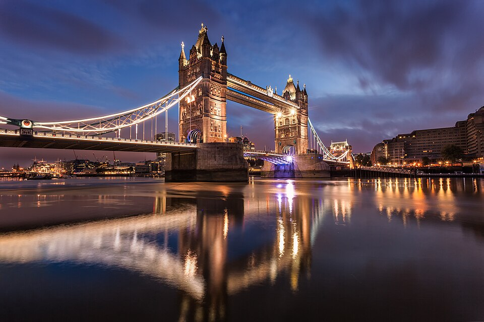
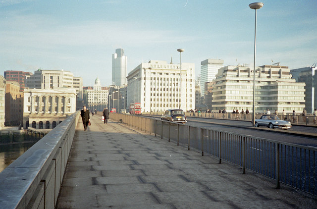
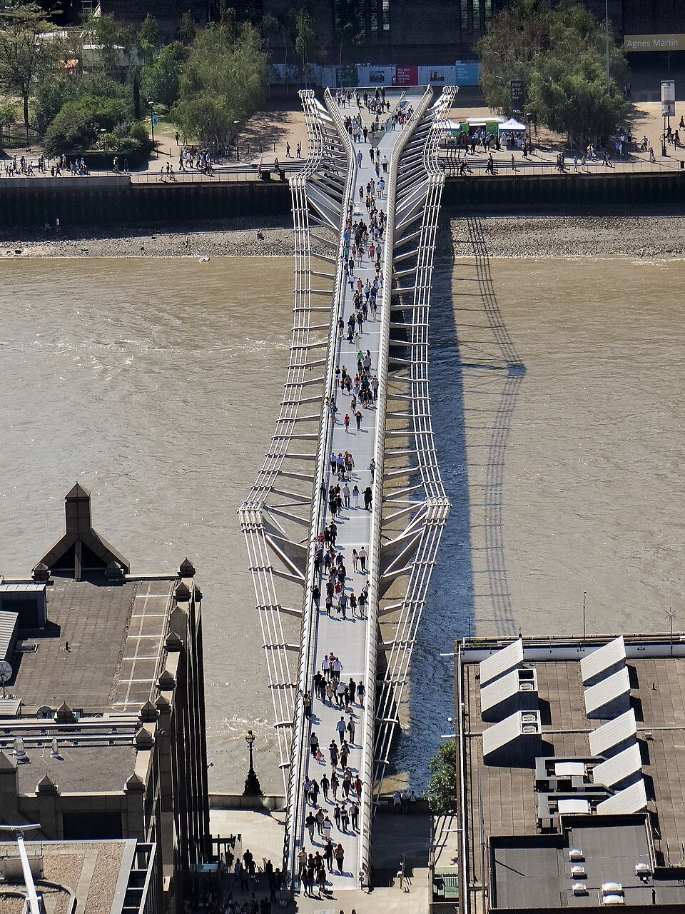

+++
title = "Thames Bridges Quiz: Over the River!"
licence = "CC BY-SA 4.0"
time_limit = 20
max_points = 1000
scoring = "linear"
floor = 0.5

[[sources]]
title = "Tower Bridge"
url = "https://en.wikipedia.org/wiki/Tower_Bridge"
revision = "2026-11-20"

[[sources]]
title = "London Bridge"
url = "https://en.wikipedia.org/wiki/London_Bridge"
revision = "2026-11-21"

[[sources]]
title = "Millennium Bridge, London"
url = "https://en.wikipedia.org/wiki/Millennium_Bridge,_London"
revision = "2026-09-16"

[[sources]]
title = "Westminster Bridge"
url = "https://en.wikipedia.org/wiki/Westminster_Bridge"
revision = "2026-10-18"

[[sources]]
title = "Hammersmith Bridge"
url = "https://en.wikipedia.org/wiki/Hammersmith_Bridge"
revision = "2026-10-15"

[[sources]]
title = "Albert Bridge, London"
url = "https://en.wikipedia.org/wiki/Albert_Bridge,_London"
revision = "2026-11-12"

[[sources]]
title = "Waterloo Bridge"
url = "https://en.wikipedia.org/wiki/Waterloo_Bridge"
revision = "2026-10-20"

[[sources]]
title = "Blackfriars Bridge"
url = "https://en.wikipedia.org/wiki/Blackfriars_Bridge"
revision = "2026-10-24"

[[sources]]
title = "Vauxhall Bridge"
url = "https://en.wikipedia.org/wiki/Vauxhall_Bridge"
revision = "2026-11-08"

[[sources]]
title = "Chelsea Bridge"
url = "https://en.wikipedia.org/wiki/Chelsea_Bridge"
revision = "2026-04-12"

[[images]]
file = "images/tower-bridge-at-dawn.jpg"
author = "Fuzzypiggy"
licence = "CC BY-SA 3.0"
source = "https://commons.wikimedia.org/wiki/File:Tower_Bridge_at_Dawn.jpg"

[[images]]
file = "images/london-bridge-geograph-org-uk-478726.jpg"
author = "David Wright"
licence = "CC BY-SA 2.0"
source = "https://commons.wikimedia.org/wiki/File:London_Bridge_-_geograph.org.uk_-_478726.jpg"

[[images]]
file = "images/millenium-bridge-2015.jpg"
author = "Ibex73"
licence = "CC BY-SA 4.0"
source = "https://commons.wikimedia.org/wiki/File:Millenium_bridge_2015.jpg"
+++

## Which Thames bridge is this?

- [x] Tower Bridge
- [ ] Albert Bridge
- [ ] Westminster Bridge
- [ ] London Bridge

Source: https://en.wikipedia.org/wiki/Tower_Bridge

## In which year was Tower Bridge opened by the Prince and Princess of Wales?

- [ ] 1906
- [ ] 1873
- [ ] 1886
- [x] 1894

Source: https://en.wikipedia.org/wiki/Tower_Bridge

## Who designed Tower Bridge, with John Wolfe Barry as engineer?

- [ ] Thomas Page
- [ ] John Rennie
- [x] Horace Jones
- [ ] Joseph Bazalgette

Source: https://en.wikipedia.org/wiki/Tower_Bridge

## Roughly how many crossings does Tower Bridge carry every day?

- [ ] 400,000
- [ ] 4,000
- [ ] 100,000
- [x] 40,000

Source: https://en.wikipedia.org/wiki/Tower_Bridge

## Which Thames bridge is this?

- [x] London Bridge
- [ ] Vauxhall Bridge
- [ ] Tower Bridge
- [ ] Blackfriars Bridge

Source: https://en.wikipedia.org/wiki/London_Bridge

## Who built the first London Bridge, a timber bridge, around AD 50?

- [ ] The Danes
- [x] The Romans
- [ ] The Saxons
- [ ] The Normans

Source: https://en.wikipedia.org/wiki/London_Bridge

## In which year did the current concrete-and-steel London Bridge open to traffic?

- [x] 1973
- [ ] 1831
- [ ] 1988
- [ ] 1962

Source: https://en.wikipedia.org/wiki/London_Bridge

## Which Thames bridge is this?

- [ ] Waterloo Bridge
- [ ] Chelsea Bridge
- [x] Millennium Bridge
- [ ] Albert Bridge

Source: https://en.wikipedia.org/wiki/Millennium_Bridge,_London

## Which cathedral's façade is framed by the Millennium Bridge's supports?

- [ ] Westminster Cathedral
- [ ] Southwark Cathedral
- [ ] Westminster Abbey
- [x] St Paul's Cathedral

Source: https://en.wikipedia.org/wiki/Millennium_Bridge,_London

## Westminster Bridge is painted to match the House of Commons seats. What colour is it?

- [ ] Red
- [ ] Yellow
- [x] Green
- [ ] Blue

Source: https://en.wikipedia.org/wiki/Westminster_Bridge

## Why was Hammersmith Bridge closed indefinitely to motor traffic in April 2019?

- [ ] A ship collision
- [x] Cracks in its pedestals
- [ ] Flood damage
- [ ] An IRA bomb

Source: https://en.wikipedia.org/wiki/Hammersmith_Bridge

## Which nickname did Albert Bridge earn for vibrating when crowds walked over it?

- [x] The Trembling Lady
- [ ] The Iron Duchess
- [ ] The Old Rattler
- [ ] The Shaky Widow

Source: https://en.wikipedia.org/wiki/Albert_Bridge,_London

## Why was the second Waterloo Bridge long known as "The Ladies' Bridge"?

- [ ] A queen opened it
- [x] Mostly women built it
- [ ] It was painted pink
- [ ] It was for walkers

Source: https://en.wikipedia.org/wiki/Waterloo_Bridge

## Which Bulgarian dissident was assassinated on Waterloo Bridge in 1978?

- [ ] Alexander Litvinenko
- [x] Georgi Markov
- [ ] Leon Trotsky
- [ ] Todor Zhivkov

Source: https://en.wikipedia.org/wiki/Waterloo_Bridge

## Which Italian banker was found hanging from Blackfriars Bridge in 1982?

- [ ] Licio Gelli
- [x] Roberto Calvi
- [ ] Michele Sindona
- [ ] Paul Marcinkus

Source: https://en.wikipedia.org/wiki/Blackfriars_Bridge

## Vauxhall Bridge, the first iron bridge over the Thames, was first given which name?

- [ ] Pimlico Bridge
- [x] Regent Bridge
- [ ] Falkes Bridge
- [ ] Lambeth Bridge

Source: https://en.wikipedia.org/wiki/Vauxhall_Bridge

## What was the first Chelsea Bridge originally called when it opened in 1858?

- [ ] Royal Bridge
- [ ] Battersea Park Bridge
- [ ] Sloane Bridge
- [x] Victoria Bridge

Source: https://en.wikipedia.org/wiki/Chelsea_Bridge
